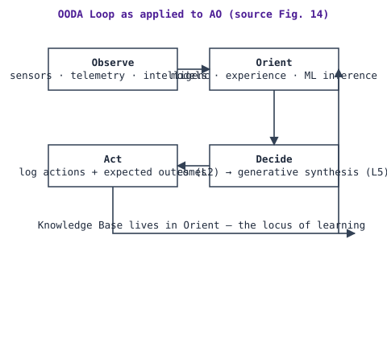
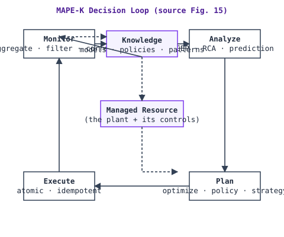

# Decision Models: OODA and MAPE(-K)

**Status:** draft (v0.1.0) · **Source:** §7.3 · **Code of record:** `model/decision-models.yaml`

Closed loops implement one or more **decision models** — formal frameworks structuring the loop's decision-making. This repository covers the two surveyed by the source document: **OODA** and **MAPE-K**. (Other models exist in the wider literature; the [Closed-Loop-Management (CLAM)](https://github.com/emmanuel-a-otchere/Closed-Loop-Management) service additionally supports a CUSTOM pass-through kind, which the AOCL model format accepts for compatibility — see [clm-alignment.md](clm-alignment.md).) **The choice of decision model is implementation-specific and not prescribed.**

> Per project direction, the source document's third surveyed decision model (§7.3, alongside these two) is **out of scope** for AOCL and appears nowhere in its model, tools, or documentation.

## OODA (Observe–Orient–Decide–Act)

Originating in military strategy (John Boyd), widely adapted to cyber-physical systems:

1. **Observe** — collect data from sensors, telemetry, and external intelligence; in AO this includes qualitative signals (customer sentiment, threat intelligence, regulatory announcements).
2. **Orient** — analyze within current models, historical experience, and situational awareness — *where raw data becomes meaningful information*. At L4–L5: ML inference, causal analysis, anomaly detection. (The Knowledge Base lives here.)
3. **Decide** — select from the feasible set, from deterministic rule-matching (L2) to generative strategy synthesis (L5); shall incorporate risk assessment and constraint checking.
4. **Act** — execute through actuators; actions logged with expected outcomes recorded for learning.

## MAPE-K (Monitor–Analyze–Plan–Execute–Knowledge)

From IBM's autonomic computing initiative; the granular decomposition for software-intensive systems:

1. **Monitor** — collect, aggregate, filter, correlate metrics/events; multiple temporal granularities and semantic layers.
2. **Analyze** — complex event processing, pattern recognition, root-cause analysis, predictive modelling.
3. **Plan** — generate or select a plan: constraint satisfaction, optimization, policy lookup; at higher maturity, strategy generation and experimental design.
4. **Execute** — effect changes through actuators/orchestrators; **atomic** where consistency is required, **idempotent** where retry is possible.
5. **Knowledge** — shared repository of models, policies, historical outcomes, learned patterns; the locus of organizational learning; supports querying, reasoning, versioning.

## Compatibility and selection

**OODA and MAPE-K are complementary**: OODA provides the strategic framing; MAPE-K the implementation architecture. Selection guidance (AOCL-derived mapping from the document's own level descriptions — deterministic table, pinned by the corpus):

| Level band | Velocity | Suggested model | Rationale |
|---|---|---|---|
| L1–L3 | any | **MAPE** | Deterministic monitor→execute chains map directly to threshold/reactive/predictive control |
| L4–L5 | tactical, slow | **OODA** | Orientation becomes the locus of learning (ML inference, causal analysis); strategic framing dominates |
| L4–L5 | fast | **MAPE** | Sub-millisecond loops keep the deterministic skeleton; learning lives in the slow loops that parametrize them |

The engine enforces this mapping (`recommended_model`), and the assessment output names the suggested model plus the level-appropriate **HITL** default (L1–L2 HITL · L3–L4 HOTL · L5 HOOTL). Both are advisory: implementation-specific choices may differ, and the ledger records what is actually deployed (`decision_model`, `hitl` fields) — a fast loop recorded with `OODA` is a coherence question worth raising, not an error.

## In the modeler

When you place a loop on a process/capability/system/function and pick a decision-model kind, the modeler generates the step editor for exactly the steps that kind requires (MAPE: monitor/analyze/plan/execute · OODA: observe/orient/decide/act · CUSTOM: free steps) — each step a **CLAM ActivityRef**: a name plus an implementation `action` reference (HTTP endpoint, function name, workflow id). The export emits these as CLAM `DecisionModel` payloads with `kind` and step refs intact.
