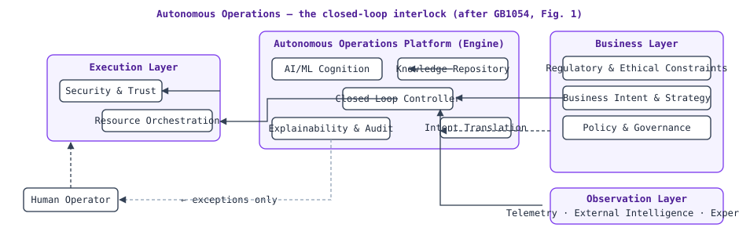
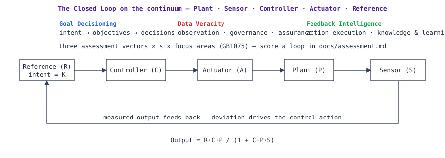

# The Framework: Autonomous Operations and Closed Loops

**Status:** draft (v0.1.0) · **Source:** *Autonomous Operations and Closed Loops* v1.2.0, TechNE Hub (§1, §2, §3.1)

## The premise

The transition from human-centric operations to Autonomous Operations (AO) restructures how digital service providers design, deploy, and manage complex sociotechnical systems. At the architectural centre of this transition lies the **Closed Loop**: a self-regulating control system in which the output of a process is measured and fed back to influence the input, reducing deviation between actual output and a desired reference.

The necessity of closed loops is not merely operational but ontological: without robust, well-governed feedback mechanisms, **autonomy collapses into unpredictability**. Loops transform control problems from reactive human-driven "incidents" into systematically manageable, machine-executable dynamic workflows operating at temporal scales far beyond human cognitive capacity.

**Autonomous Operations** is defined normatively by TechNE Hub GB1054 as: *"an operating model of an organisation that automates capabilities for learning, self-governance, and self-adaptation of its value streams in order to realize stakeholder value in a closed-loop fashion."* AO is not synonymous with automation: automation is a lever; autonomy implies bounded independent decision-making, including for novel situations not programmed at design time.

## The loop anatomy

In control-theory terms, a Closed Loop consists of:

- **Plant (P)** — the system or process being controlled (a radio access network, a compute cluster, a support workflow);
- **Sensor (S)** — the mechanism observing the plant's output state;
- **Controller (C)** — the logic comparing observed state to desired state, computing a control action;
- **Actuator (A)** — the mechanism by which the controller influences the plant;
- **Reference (R)** — the desired state or set point (intent / goal / expectation — the invariant purpose *K*).

The transfer function of a basic negative feedback loop: `Output = R·C·P / (1 + C·P·S)`, where the denominator is the feedback factor; large loop gain makes the output track the reference and reject disturbances.

In telecom and digital-service operations, loops extend beyond classical control into four control families: **commerce** loops (revenue per user, satisfaction), **service** loops (latency, throughput, availability, jitter), **resource** loops (CPU, spectrum, power, capacity), and **security** loops (threat posture, anomalies).

## The Control Problem

The Control Problem of AO is maintaining a complex sociotechnical system within acceptable boundaries despite uncertainty, failures, demand variability, and strategic evolution. It decomposes into three sub-problems:

1. **Stabilization** — remain in, or return to, a desired equilibrium (classical regulation).
2. **Optimization** — dynamically discover superior operating points, not merely hold set points.
3. **Adaptation** — modify the control strategy itself as environment, plant, or objectives change (the meta-control problem).

A loop's **maturity level determines which sub-problems it can address and how effectively** — see the [maturity model](maturity-model.md).

## The GB1054 operating model and the MAMA foundations

GB1054 characterizes the AO operating model through six interconnected elements — **Processes, Organisation, Location, Information, Suppliers, Management Systems** — underpinned by the four foundations of the TechNE Hub Measuring and Managing Autonomy (MAMA) framework: **Process** (workflows performed by autonomous "things"), **Integration** (level and methods of automated data sharing), **People** (roles of employees, managers, customers, partners), and **Platforms & Governance** (technology and policy enabling automation, self-adaptability, self-governance).

> Identity note: the "MAMA" of GB1040 (above) is a TechNE Hub project — distinct from the lowercase `mama` autonomy method and the MAMA umbrella organization. See [naming.md](naming.md).

## The loop continuum

Loops span a multidimensional space, not a single axis:

- **Temporal** — batch/hourly → real-time/sub-millisecond;
- **Cognitive** — rule-based logic → AI-driven reasoning;
- **Scope** — single-parameter adjustment → cross-domain orchestration;
- **Governance** — rigid human-approved policies → dynamically evolving constraints.

The four fundamental functions loops serve in AO architectures: **state regulation**, **disturbance rejection**, **set-point tracking**, and **learning & adaptation** (the latter emerging at L4–L5, where the controller itself evolves).

## What this repository adds

The guide's concepts, harvested and sharpened into: a machine-readable [model](../model/) with schemas; an [assessment instrument](assessment.md) with a weakest-link aggregation rule; a versioned [realization model](realization-model.md) with solvers; the [loop velocity taxonomy](loop-velocity.md) with budgets; [decision-model guidance](decision-models.md) (OODA, MAPE); a [loop modeler](loop-modeler.md) producing [CLAM-aligned](clm-alignment.md) specifications; and a [loop ledger](ledger-format.md) with health checks.
