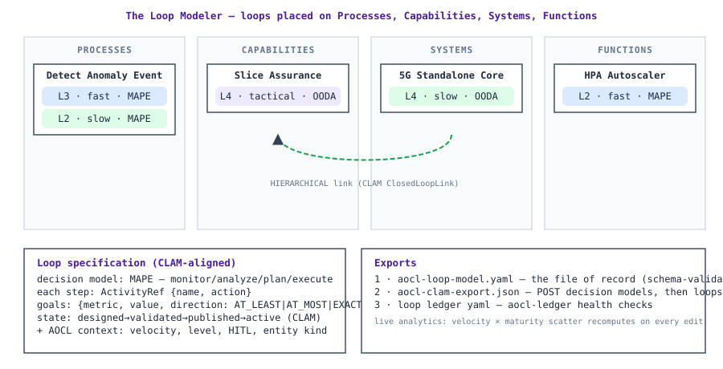

# The Loop Modeler

**Status:** draft (v0.1.0) · **Site:** *Loop Modeler* tab · **Format:** `model/loop-model.yaml` + `schema/loop-model.schema.json` · **CLI:** `aocl-model`

The modeler is a visual layout for the question the source document's operational mandate poses: **which closed loops run on which processes, capabilities, systems, and functions — at what maturity, at what velocity, specified how?**

## What you do

1. **Register entities** — the things loops apply to, in four kinds:
   - **Process** — a value-stream stage or operational workflow (e.g. "Detect and Handle Anomaly Event")
   - **Capability** — an organizational or technical capability (e.g. "Slice Assurance")
   - **System** — a platform, network domain, or application (e.g. "5G Standalone Core")
   - **Function** — a discrete technical function or service (e.g. "HPA Autoscaler")
2. **Place loops** on entities — each loop chip carries its velocity (fast/tactical/slow) and maturity level (L1–L5, slider).
3. **Specify each loop** in the **CLAM-aligned format**: decision model (MAPE/OODA/CUSTOM) with named steps and implementation `action` refs; goals in the CLAM `Goal` shape (`{metric, value, unit?, direction: AT_LEAST|AT_MOST|EXACTLY}`); CLAM lifecycle state; owner; notes. HITL defaults to the level's model (L1–2 HITL · L3–4 HOTL · L5 HOOTL) and may be overridden (recorded, not silently normalized).
4. **Link loops** — `HIERARCHICAL` (slow loop governing fast loops), `FEEDBACK`, `DAISY_CHAIN` — the CLAM `ClosedLoopLink` kinds, honoring the [orchestration principles](loop-velocity.md#inter-loop-orchestration-principles).
5. **Watch the analytics update live** — the portfolio view re-renders the velocity × maturity scatter from the model state.

## Validation (client and CLI agree)

The modeler validates as you edit (id slugs, entity references, level 1–5, decision-model step completeness per kind, goal shape, `level` vs `vector_scores` weakest-link consistency, link endpoints); `aocl-model <file>` performs the same validation on the file. Consistency problems are **errors**, not warnings — a model claiming L5 with FI at L3 is a contradiction, not a style issue.

## Exports

| Export | Format | Consumer |
|---|---|---|
| **Loop model YAML** | `aocl-loop-model` (schema `loop-model.schema.json`) | The file of record; `aocl-model` validates; `aocl-ledger` consumes the derived ledger |
| **CLAM payloads** | `aocl-clam-export` (schema `clm-export.schema.json`) | POST into the [CLAM service](clm-alignment.md) — decision models first, then closed loops |
| **Ledger YAML** | loop-ledger schema 1 | `aocl-ledger` health checks |

State persists in the browser (localStorage) — nothing leaves the machine. Import accepts the model as JSON; the canonical YAML round-trips through `aocl-model`.

## The sample model

*Load sample* installs three synthetic loops illustrating the pattern: a **fast MAPE L3** loop on the *Detect Anomaly Event* process (predictive signals → pre-emptive scaling, goal `detection_latency_ms ≤ 10000`), a **slow OODA L4** loop on the *5G Standalone Core* system (digital-twin orientation → policy deployment), `HIERARCHICAL`-linked down to the fast loop — and a **fast MAPE L2** autoscaler function. Each is a starting shape to edit, not a reference implementation.
