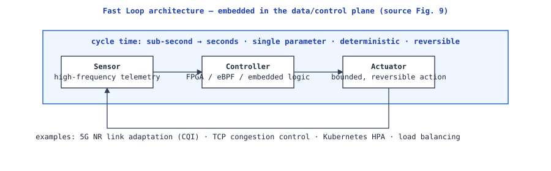
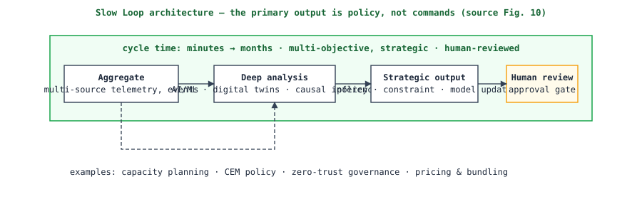
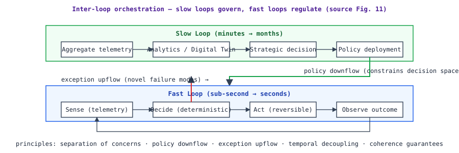

# Loop Velocity: Fast, Tactical, Slow

**Status:** draft (v0.1.0) · **Source:** §5, Tables 2–3 · **Code of record:** `model/velocity.yaml`

Not all loops operate at the same temporal scale. **Velocity** — the inverse of the cycle time from observation through actuation — is a primary architectural parameter determining suitable domain, technology stack, and governance model.

## Taxonomy (Table 2)

| Attribute | Fast Loops | Slow Loops |
|---|---|---|
| Cycle time | Sub-second to seconds | Minutes to months |
| Data granularity | High-frequency telemetry | Aggregated metrics, events |
| Decision complexity | Single-parameter, deterministic | Multi-objective, strategic |
| Governance model | Automated, policy-enforced | Human-reviewed, intent-driven |
| Technology | Embedded controllers, FPGA, eBPF | AI/ML platforms, digital twins |
| Failure mode | Localised, recoverable | Systemic, consequential |
| Typical domain | RAN optimization, traffic engineering | Capacity planning, policy evolution |

The document's latency-budget table (Table 3) also defines a middle **Tactical** band (minutes–hours, policy-enforced with human notification) — carried here as the third class.

## Fast loops

Embedded in the data/control plane; continuous high-frequency regulation. Four properties (source §5.2): **latency sensitivity** (a radio link-adaptation loop completes within the channel's coherence time — often milliseconds); **deterministic behaviour** (non-deterministic AI inference is generally unsuitable for sub-millisecond loops without guaranteed-inference hardware); **local scope** (a single cell, link, or microservice instance); **imperative, reversible actions**. Examples: 5G NR link adaptation from CQI; TCP congestion control; Kubernetes HPA; load-balancer distribution.

## Slow loops

Tactical/strategic velocities; aggregate observations from many fast loops. Their **primary output is not an actuation command but a policy, constraint, or model update that parametrizes fast-loop behaviour**. They employ deeper reasoning (digital twins, causal inference, generative models) and **incorporate human review for strategic decisions**. Examples: capacity planning authorizing build-outs; CEM loops correlating NPS with network KPIs; zero-trust policy governance; pricing/bundling optimization.

## Reference latency budgets (Table 3)

| Class | Observation | Decision | Actuation | End-to-end | Availability SLO |
|---|---|---|---|---|---|
| Fast | < 10 ms | < 10 ms | < 10 ms | < 100 ms | 99.999% |
| Tactical | < 1 min | < 5 min | < 1 min | < 10 min | 99.99% |
| Slow | < 1 hour | < 24 hours | < 4 hours | < 7 days | 99.9% |

When defined, these are **architectural constraints**: loops that consistently violate their budgets shall be **decomposed, optimized, or downgraded in maturity**. The ledger records `budget_end_to_end` per loop and warns on fast loops without one.

## Inter-loop orchestration principles

1. **Separation of concerns** — fast loops manage local stability; slow loops manage global optimization and strategic alignment. A fast loop shall not violate slow-loop policy; a slow loop shall not micromanage fast-loop cycle times.
2. **Policy downflow** — slow-loop policies constrain fast-loop decision spaces, distributed with guaranteed propagation times.
3. **Exception upflow** — novel failure modes beyond a fast loop's playbook are buffered and escalated for analysis and policy update.
4. **Temporal decoupling** — buffering/aggregation layers between the classes; a fast loop never blocks on a slow loop's decision.
5. **Coherence guarantees** — versioned policy snapshots and atomic updates; fast loops never operate under conflicting policies during propagation.

These principles are exactly what the [modeler's link types](loop-modeler.md) express: `HIERARCHICAL` (slow → fast composition), `FEEDBACK` (target's output consumed by source's feedback path), `DAISY_CHAIN` (peer-to-peer) — all CLAM `ClosedLoopLink` kinds.
