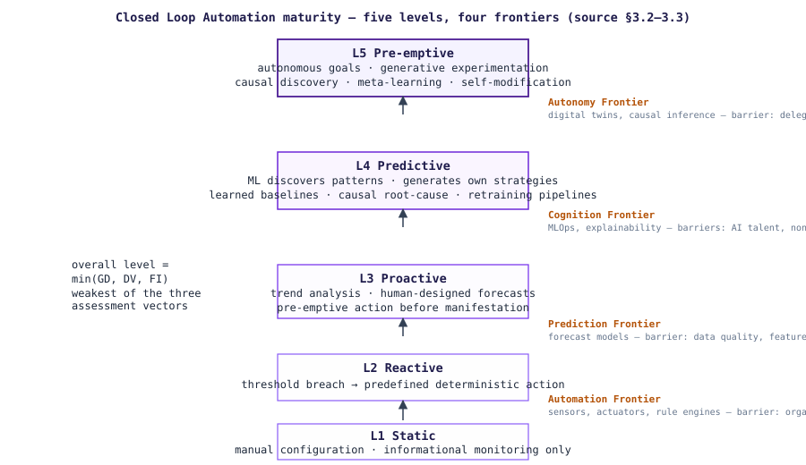
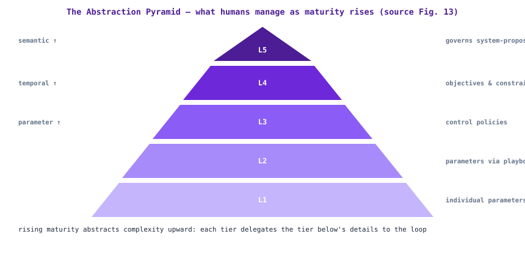

# The Closed Loop Maturity Model (L1–L5)

**Status:** draft (v0.1.0) · **Source:** *Autonomous Operations and Closed Loops* v1.2.0, §3.2–3.3 · **Code of record:** `model/levels.yaml`

Five levels of Closed Loop Automation (CLA) maturity, assessed across three vectors — **Goal Decisioning (GD)**, **Data Veracity (DV)**, **Feedback Intelligence (FI)** — each characterized per level in `model/levels.yaml` and scoreable via the [assessment instrument](assessment.md). **The loop's overall level is the weakest of its three vectors** (the AOCL aggregation rule; see [assessment.md](assessment.md#aggregation)).

## The ladder

| Level | Name | In one line | Human role | Control-problem coverage |
|---|---|---|---|---|
| L1 | **Static** | Pre-defined loops, manual configuration, no adaptation | Humans *are* the loop | Stabilization, rudimentarily (by preventing change) |
| L2 | **Reactive** | Threshold breaches trigger predefined deterministic actions | Humans design playbooks; loop executes design-time decisions | Stabilization for known, bounded perturbations |
| L3 | **Proactive** | Trend analysis and human-designed forecasts trigger pre-emptive action | Humans build the models; loop operates within them | Stabilization improved; Optimization begins |
| L4 | **Predictive** | ML discovers patterns and generates/refines its own strategies, including partially novel scenarios | Humans set learning objectives, guardrails; audit decisions | Stabilization + Optimization; Adaptation begins |
| L5 | **Pre-emptive** | Self-governed goals, generative experimentation, causal discovery, meta-learning, self-modification | Humans provide intent, ethics, exceptions | All three, with full autonomy within bounded constraints |

**The L3/L4 distinction** (the document's own note): L3 executes predictions *designed by humans* for known failure modes; L4 *learns new strategies from data*, including for scenarios its designers did not foresee.

Vector characteristics per level (from the CLA-maturity research, carried in the foundational corpus §3.2) — e.g. Goal Decisioning: *fixed goals, rigid rules* (L1) → *dynamic goals, post-event adjustment* (L2) → *scenario-based anticipation* (L3) → *AI-driven optimization, anticipatory goals* (L4) → *self-governed goals, experimental learning* (L5). Full table: `model/levels.yaml`.

## Transition criteria

An organization classifies a loop at the next level when (normative for organizations electing formal assessment):

- **L1→L2**: automated thresholds trigger predefined corrective actions without human initiation.
- **L2→L3**: trend analysis or predictive indicators anticipate breaches before they occur.
- **L3→L4**: AI/ML techniques are employed for continuous learning, pattern discovery, and dynamic strategy generation.
- **L4→L5**: the system autonomously sets or modifies its own goals, experiments with novel strategies, and operates with minimal human-defined constraints.

## The four frontiers

Progression is not linear in effort or time; each crossing is a distinct transformation:

| Frontier | Transition | Requires | Primary barrier |
|---|---|---|---|
| **Automation** | L1→L2 | Instrumentation, orchestration, rule engines | Organizational trust |
| **Prediction** | L2→L3 | Data science capability, forecast models | Data quality, feature engineering |
| **Cognition** | L3→L4 | AI/ML infrastructure, model governance, MLOps, explainability | AI talent scarcity; non-stationary environments |
| **Autonomy** | L4→L5 | Experimentation infrastructure, digital twins, causal inference | Philosophical: delegating goal-setting to machines |

`aocl-score` reports the frontier for a loop's current level — see the engine (`src/aocl/assess.py`).

## AOMM capability mapping (relevance, not equivalence)

The source document maps closed-loop capability onto the six Autonomous Operations Maturity Model (AOMM) dimensions — Party, Strategy, Technology, Operations, Culture, Data — at L1/L3/L5. It is explicitly **a relevance characterisation, not a level equivalence**. The full table: [aomm-mapping.md](aomm-mapping.md). The document's warning stands as design guidance: **advancing loop maturity without corresponding advancement in the Data and Culture dimensions is a common failure mode.**

## Abstraction at higher levels

Across all reference use cases, rising maturity progressively abstracts operational complexity along three dimensions:

- **Parameter**: manage parameters (L1–L2) → policies (L3) → objectives and constraints (L4) → govern system-proposed intents (L5).
- **Temporal**: respond to events (L1–L2) → policy windows (L3) → strategic horizons (L4) → system-proposed horizons (L5).
- **Semantic**: interpret raw metrics (L1–L2) → policy semantics (L3) → business-term intent (L4) → govern proposed intents (L5).

*Operational mandate (source §6): map all value streams to the five CLM levels; define the HITL/HOTL/HOOTL model for every process stage; invest in Data Veracity as the primary multiplier of platform complexity; target maturity levels from the ROI of the effort-vs-realization curve.*
