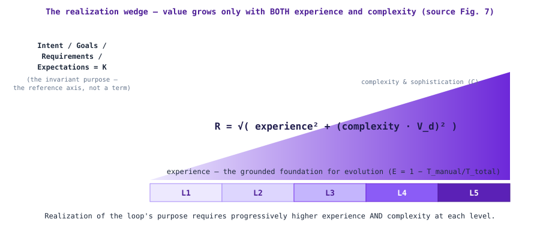

# The Realization Model

**Status:** draft (v0.1.0) · **Source:** *Autonomous Operations and Closed Loops* v1.2.0, §4 (informative) · **Code of record:** `model/realization.yaml`, `src/aocl/realization.py`

> **Status of this model: informative.** The source document is explicit — the formulae, tables, and figures of its Section 4 are **planning heuristics and illustrative references**, carrying no normative weight and never to be used for contractual commitments or certification purposes. This repository preserves that framing on every surface (CLI output, site banner, exports).

## The core thesis: realization is a cost-benefit decision

Everything in this model serves one postulate:

> **Organizations invest in the sophistication of automating the adaptability, self-governance and decisioning of operational processes and systems** — driving closed loops toward the Self-X mode, with humans out of the loop except *on-the-loop* for policy setting, observability and intent provisioning. **The cost of that investment — the automation engineering and the systems that must be put in place to realize higher maturity levels (L4–L5) — follows an exponential relationship, while incremental gains diminish as you go higher.** The L3–L4 boundary is where diminishing returns inflect toward compounding ones; it is the investment decision point.

The two terms of the postulate:

- **Complexity (C)** is the *cost driver*: the technical sophistication of such automated operations — the closed loops operating toward their level's Self-X mode; the **data-fusion requirements** (how the automation harnesses data *variety* to inform decisioning models and to learn and adapt); and the **interwoven nature of the loops** (coupling across composed and coordinated loops). Concretely: every integration, data pipeline, model, governance control and inter-loop dependency an organization must build and operate.
- **Experience (E)** is the *benefit carrier*: the stability, ease of use and "Self-X" properties delivered to the operator or observer and the actual end user — from high required effort at low maturity to extremely-low-to-nothing at L5, where the residual human role is precisely the on-the-loop triad (policy, observability, intent provisioning).

Realization effort in real life is **cost to realize**. The model's claim — exponential effort (`E_f = e^R`), logarithmic value through L1–L3, compounding value only after the L3–L4 inflection — is a **decision instrument**: it tells an organization, per loop, whether the next level's marginal effort is justified by the marginal value, or whether the loop should be held at L3 and the investment redirected. Used that way (calibrated with the organization's own cost and value data), the model graduates from heuristic to decision model — without ever becoming a certification or contractual metric ([ADR-007](decisions/adr-007-realization-cost-benefit-instrument.md)).

## The formula

$$R = \sqrt{E^2 + (C \cdot V_d)^2}$$

Realization is the **Euclidean norm of the Experience–Complexity vector**, with the complexity term scaled by the **Data Veracity Index**. Intent / Goals / Requirements / Expectations (= *K*) are the loop's invariant purpose — the reference axis — **not** a peer term of E and C; Goal Decisioning is intentionally absent from the formula.

- **E (Experience)** ∈ [0, 1]: `E = 1 − T_manual/T_total` — normalized reduction in manual intervention.
- **C (Complexity)** ≥ 0: technical sophistication — data sources, AI model depth, interwoven loops (values above 1.0 indicate sophistication beyond the L3 reference).
- **V_d (Data Veracity)** ∈ [0, 1]: multiplies C. If V_d is low, even the most complex AI model fails to deliver realization — which mandates **data governance as a process-based system**.

**Worked example (from the document, §4.1.3):** E = 0.6, C = 0.8, V_d = 0.9 → R = √(0.36 + 0.5184) ≈ **0.94**, consistent with a solid L3 loop. If veracity falls to V_d = 0.5 → R ≈ **0.72**: poor data quality caps the value any given complexity can deliver. Both cases are pinned in the golden corpus and run against both engines in CI.

## The four-vector decompositions

**Complexity** (per the document, four orthogonal components):
`C = √(Cs² + Cd² + Cm² + Cc²)`
**Cs** structural (components, interfaces, dependencies, configuration) · **Cd** dynamic (rate of state change, traffic burstiness, topology churn) · **Cm** semantic (intent ambiguity, stakeholder multiplicity, regulatory nuance) · **Cc** coupling (cascading failure modes, hidden feedback paths, emergent behaviour).

**Experience**:
`E = √(Ed² + Em² + Eo² + Ex²)` (clamped to [0, 1])
**Ed** data experience (learning samples) · **Em** model experience (RMSE, AUC, causal-effect precision) · **Eo** operational experience (scenario coverage of runbooks, post-mortems, heuristics) · **Ex** meta-experience (transfer/few-shot/AutoML learning-rate acceleration).

## Limits and balance (the geometric reading)

- **Zero-Complexity limit**: C → 0 ⇒ R → E. Simple loops realize value proportional to their embedded knowledge.
- **Zero-Experience limit**: E → 0 ⇒ R → C·V_d. Inexperienced organizations achieve only raw complexity-matching.
- **Balanced growth**: maximum realization efficiency when E and C grow in proportion. High-C/low-E is **unstable**; high-E/low-C is **underutilized**.

## Effort asymmetry and the sigmoid

Effort factor: `E_f = e^R` (α = 1). Two value models compose into a **sigmoid**:

- **Logarithmic** (L1–L3): `Value(L) = V_max·ln(1+αL)/ln(1+α·5)` — the manual→reactive transition yields the dramatic gains; later gains are incremental.
- **Exponential** (L≥3): `Value(L) = V_0·exp(β(L−3))` — compounding learning effects, cross-loop network effects, non-obvious optimizations.

The inflection sits at the **L3–L4 boundary**: the transition from human-designed control to machine-discovered control. The document's validation analysis: moving L4→L5 (95% zero-touch) demands **more than double** the platform complexity (1.5 → 3.5) and roughly **7× the realization effort** — *the last 5% of manual effort is the most complex to eliminate.*

> **Precision note (improvement over the source):** the published Table 1.1 effort column computed e^R from R *rounded to two decimals* (e.g. e^3.63 = 37.71). The engines compute effort from the unrounded R (e^3.62665… = 37.59). The golden corpus pins the unrounded values; `model/realization.yaml` preserves the published table as reference points.

Table 1.1 reference points (theoretical illustrations, not measured benchmarks):

| Level | Target E | Required C | R | Effort (published / unrounded) |
|---|---|---|---|---|
| L1 Static | 0.10 | 0.10 | 0.14 | 1.15 / 1.15 |
| L2 Reactive | 0.30 | 0.40 | 0.50 | 1.65 / 1.65 |
| L3 Proactive | 0.60 | 0.80 | 1.00 | 2.72 / 2.72 |
| L4 Predictive | 0.80 | 1.50 | 1.70 | 5.47 / 5.47 |
| L5 Pre-emptive | 0.95 | 3.50 | 3.63 | 37.71 / 37.59 |

## What the tools add (beyond the document)

- **Sensitivity**: ∂R/∂E = E/R, ∂R/∂C = C·V_d²/R, ∂R/∂V_d = C²·V_d/R — where an incremental investment buys the most realization.
- **Inverse solvers**: given E and a target R, the required C (`required_complexity`); given C and a target R, the required E — with infeasible targets (R < E or R < C·V_d) rejected explicitly.
- **Component composition**: four-vector E and C computed from their parts.
- **Graphed analytics** on the site: E–C plane with iso-R arcs and the Table 1.1 points, the composite sigmoid with your position, and the effort curve — see the *Realization* tab.

## The investment decision table (`aocl-realization --decide`)

The marginal cost-benefit analysis per level transition — the tool form of the thesis. Effort multiples from the Table 1.1 reference points; value multiples from the two value models; the L3→L4 gate flagged:

| Transition | Effort multiple | Value multiple | Benefit / effort |
|---|---|---|---|
| L1→L2 | 1.43× | 1.58× | **1.11** — the automation frontier pays first |
| L2→L3 | 1.65× | 1.29× | **0.78** — diminishing returns begin |
| **L3→L4** | 2.01× | 2.72× | **1.35 — INFLECTION GATE**: value switches to the compounding model |
| L4→L5 | 6.89× | 2.72× | **0.40** — the exponential cost dominates |

Reading: L1→L2 and the L3→L4 crossing are the two justified investments *under the uncalibrated reference model*; L2→L3 and L4→L5 require organizational calibration and per-loop value evidence before commitment. This is the thesis as a decision procedure — always re-run with your own measured E, C, V_d and calibrated effort/value factors.

## Design rules (source §4.6)

1. **Complexity budgeting** — when structural complexity exceeds organizational experience, decompose into nested sub-loops, each within its own complexity–experience envelope.
2. **Experience investment** — raise E (data pipelines, model governance, knowledge management) before controlling high-complexity domains autonomously.
3. **Maturity sequencing** — do not attempt L4/L5 until L3 operational stability is achieved; premature cognitive automation adds risk without commensurate value.
4. **Safety margins** — bound R by risk appetite and regulatory limits; if exceeded, **degrade the loop's maturity or escalate to humans**.
